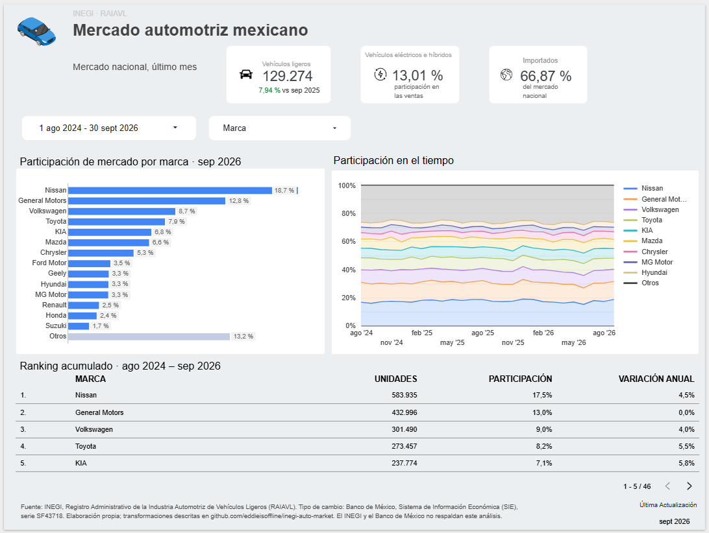
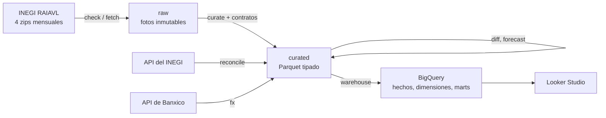
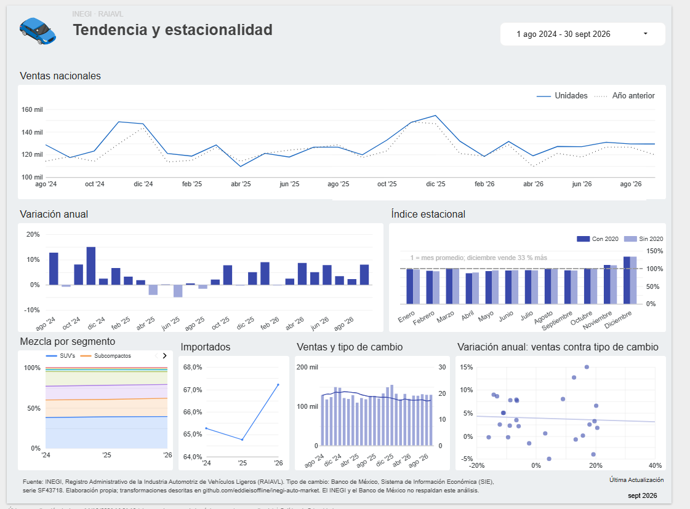
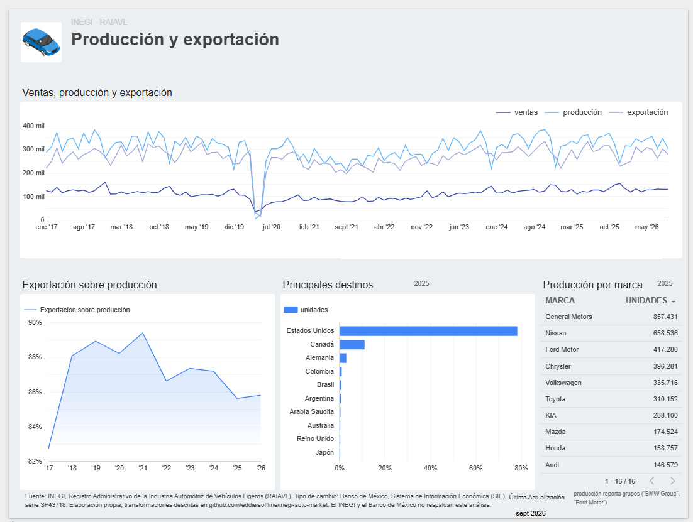
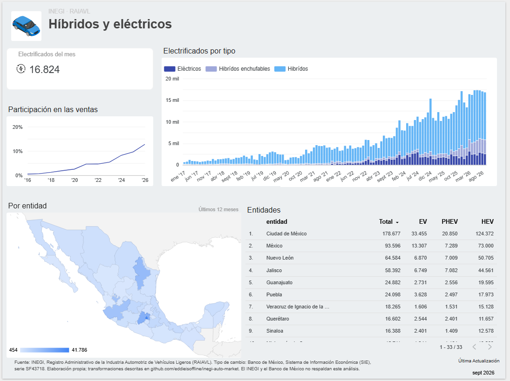
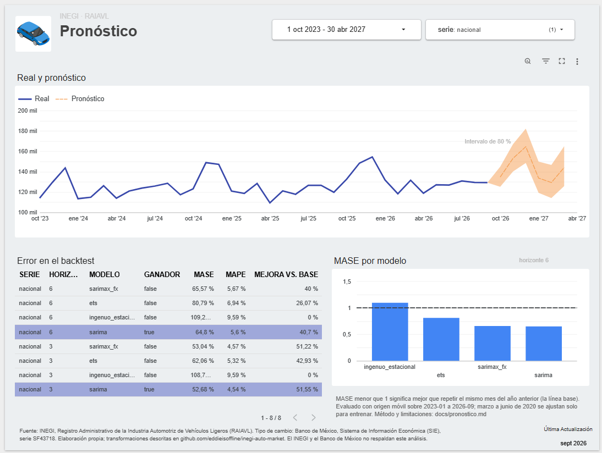
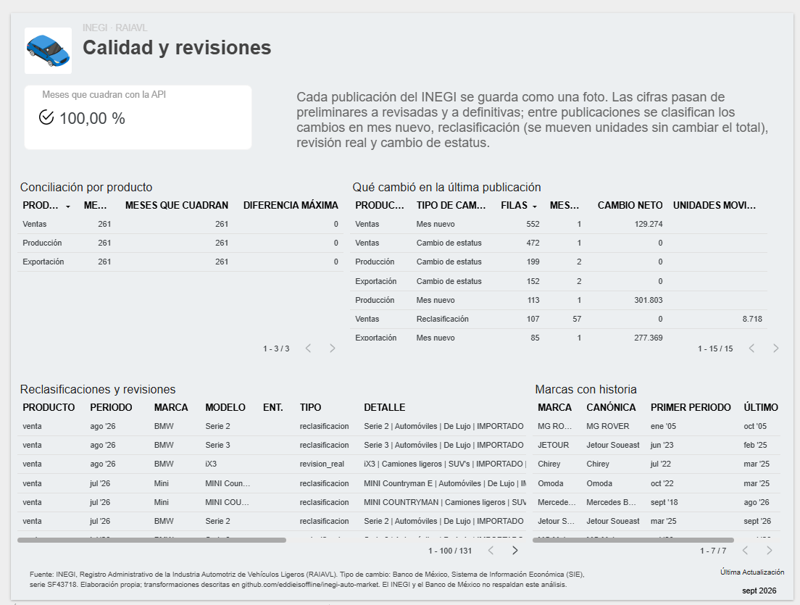
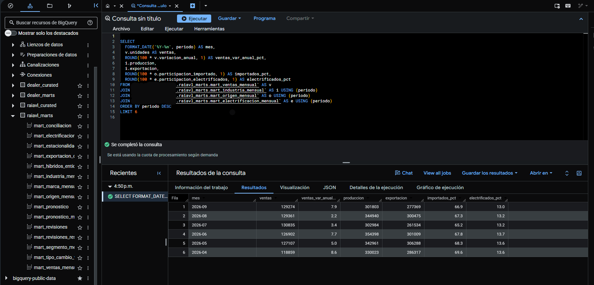
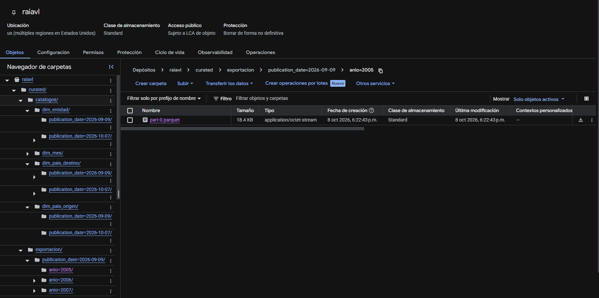
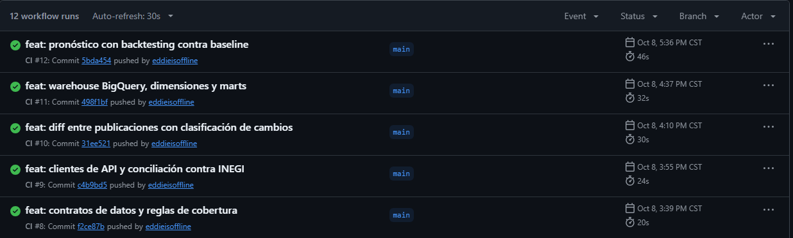

# inegi-auto-market

[](https://github.com/eddieisoffline/inegi-auto-market/actions/workflows/ci.yml)

Mercado automotriz de México con datos públicos y vivos del INEGI (ventas, producción,
exportación y venta de híbridos y eléctricos de vehículos ligeros, desde 2005) y del
Banco de México (tipo de cambio). Un pipeline guarda cada publicación mensual como una
foto inmutable, la valida, la concilia contra la API del INEGI, mide qué cambió entre
publicaciones, pronostica las ventas y alimenta un warehouse en BigQuery.

**Pregunta:** ¿cómo evolucionan las ventas por marca, qué tan estacionales son y cuánto
las explica el tipo de cambio? Con un pronóstico a 3–6 meses que solo se reporta si le
gana a la línea base.

Cifras con la publicación del 7 de octubre de 2026 (datos de 2005-01 a 2026-09).

**Dashboard:** [Mercado automotriz de México en Looker Studio](https://datastudio.google.com/reporting/cda06336-ca03-4f2f-9e40-a6b301ee36d2),
seis páginas sobre los marts de BigQuery: mercado, tendencia, industria, electrificación,
pronóstico y calidad.

[](https://datastudio.google.com/reporting/cda06336-ca03-4f2f-9e40-a6b301ee36d2)

## Hallazgos

**El mercado.**

- **Recuperado y en máximos recientes.** En 2025 se vendieron 1.52 millones de vehículos
  ligeros, 16 % más que en 2019. El récord sigue siendo 2016 (1.61 millones) y el piso,
  2020 (0.95 millones, −28 % contra 2019). De enero a septiembre de 2026 las ventas van
  5 % arriba del mismo periodo de 2025.
- **China ya es el segundo origen de lo que se vende.** Los vehículos hechos en China
  pasaron de 0 % de las ventas en 2016 a 20.1 % en 2025 y 23.0 % en lo que va de 2026,
  solo detrás de los hechos en México (35 %). Ganan mercado marcas nuevas o recientes
  (Geely, de 0 % a 2.9 %; Changan, de 0 % a 1.4 %; MG Motor, de 1.0 % a 3.4 %),
  mientras Nissan baja de 20.5 % a 17.4 % y Honda de 4.4 % a 2.6 %
  (doce meses a septiembre de 2021 contra doce meses a septiembre de 2026). Nissan sigue
  liderando.
- **Dos de cada tres autos vendidos son importados** (67 % en 2026), aunque México
  produce 2.6 veces lo que vende: en 2025 produjo 3.95 millones y exportó el 86 %, el
  78 % de eso a Estados Unidos y el 11 % a Canadá.
- **La electrificación se acelera.** Eléctricos, híbridos e híbridos plug-in pasaron de
  0.5 % de las ventas en 2016 a 9.6 % en 2025 y 12.8 % en 2026; de enero a septiembre
  de 2026 ya se vendieron casi tantos como en todo 2025.
- **SUV, el segmento dominante.** Pasaron de 18 % de las ventas en 2010 a 39 % en 2025;
  los subcompactos cayeron de 36 % (2015) a 21.5 %.

**Estacionalidad y tipo de cambio.**

- **Diciembre vende 33 % más que un mes promedio** y abril 13 % menos (índice
  estacional por razón a media móvil, 2005–2026). Sin 2020, diciembre queda igual y
  abril pasa de 0.87 a 0.89.
- **El tipo de cambio explica poco.** La correlación entre la variación anual de las
  ventas y la del tipo de cambio es débil: −0.22 en el mismo mes, −0.18 con 6 meses de
  rezago y +0.03 con 12 (sin 2020 y 2021). En el pronóstico, agregarlo con 6 meses de
  rezago mejora un poco a General Motors, Toyota y KIA y empeora la serie nacional,
  Nissan y Volkswagen.

**Pronóstico.** Con validación de origen móvil sobre 45 meses (2023-01 a 2026-09),
SARIMA reduce a la mitad el error de repetir el mismo mes del año anterior para las
ventas nacionales a 1–3 meses (MASE 0.527 contra 1.087; error medio de 4.5 %) y en 41 %
a 1–6 meses. En las cinco marcas más grandes el mejor modelo también le gana a la línea
base, aunque no siempre es el mismo. Pronóstico nacional: 164,473 vehículos en
diciembre de 2026 (intervalo de 80 %: 148,527 a 182,132).
[Método y tablas](docs/pronostico.md).

**Los datos cambian, y el pipeline lo mide.**

- **Una publicación puede reescribir el pasado sin cambiar el total.** En octubre de
  2026, BMW movió 8,717 unidades de "Serie 2" y "Serie 3" importados a modelos
  nacionales nuevos, de diciembre de 2021 a agosto de 2026 (105 combinaciones de mes y
  modelo). El total histórico de ventas cambió en 1 unidad (BMW iX3, agosto de 2026).
  En híbridos, 74 unidades pasaron de "híbridas" a "plug-in" en 23 estados, con neto
  cero.
- **Los totales cuadran con la fuente oficial.** Los 261 meses de ventas, producción y
  exportación coinciden exacto con el Banco de Indicadores del INEGI.
- **Las cifras pasan a definitivas un mes a la vez.** En octubre solo septiembre de
  2023 pasó a definitivas, aunque la nota oficial dice que el cambio es en febrero; la
  API, en cambio, marca todo 2023 con el mismo código de estatus (su significado no está
  documentado). Hipótesis: los archivos siguen una ventana móvil de 36 meses.
- **Calidad de origen:** 137 claves repetidas (0.11 % de las unidades, se suman), 87
  correcciones negativas, marcas que cambian de nombre (JETOUR → Jetour Soueast) y un
  servidor con réplicas que no coinciden en sus cabeceras.

## Arquitectura



El lake vive en una carpeta local o en Cloud Storage con el mismo código. El warehouse es
SQL de BigQuery que también corre en DuckDB sobre el lake local (traducido con sqlglot),
así se valida con datos reales sin la nube. Detalle: [docs/arquitectura.md](docs/arquitectura.md).

## Alcance y validación

| Componente | Validación con datos reales |
| --- | --- |
| Detección y descarga | `fetch` contra el servidor del INEGI: 4 zips (69 MB) en 141 s, idénticos byte a byte a los descargados a mano; sin publicación nueva no descarga nada |
| Ingesta a raw | Las dos publicaciones (8 zips) quedan con los bytes originales; repetir no escribe nada |
| Capa curated y contratos | 640,889 filas; totales mensuales iguales a la suma de los CSV y a las cifras oficiales; los contratos detienen un lote con meses faltantes |
| Conciliación y tipo de cambio | 261 de 261 meses cuadran con la API del INEGI en ventas, producción y exportación; 5,477 días de tipo de cambio FIX |
| Comparación entre publicaciones | Encuentra la reclasificación de BMW y la revisión del iX3 (−1) entre las dos publicaciones |
| Warehouse | 48 sentencias aplicadas en BigQuery; los marts dan los mismos resultados en BigQuery y en DuckDB |
| Pronóstico | El modelo ganador le gana a la línea base en las 6 series y en los dos horizontes |
| Dashboard | Seis páginas en Looker Studio sobre los marts de BigQuery |
| CI | `ruff` y 239 pruebas sin red en cada push |

## Decisiones de diseño

- **Cada publicación es una foto inmutable,** identificada por la fecha `modified` de su
  metadato; un zip regenerado con los mismos datos no cuenta como cambio y una corrección
  silenciosa detiene la ingesta ([arquitectura](docs/arquitectura.md#principios-de-diseño)).
- **Detectar sin descargar:** un HEAD por zip, con 10 minutos de tolerancia en
  `Last-Modified` porque las réplicas del servidor no coinciden en sus cabeceras
  ([arquitectura](docs/arquitectura.md#principios-de-diseño)).
- **Los duplicados se suman por el nombre original del modelo:** con el nombre
  normalizado se fusionarían 113 claves que el INEGI reporta por separado, como "Tacoma"
  y "Tacoma-" ([reglas de curated](docs/reglas_curated.md#reglas)).
- **Contratos calibrados con la historia:** aplicados a cada mes desde 2006, habrían
  frenado un solo lote en 249 meses, la salida real de Chirey en abril de 2025
  ([contratos](docs/contratos.md#calibración-con-datos-reales)).
- **Las publicaciones se comparan a nivel de marca y modelo normalizado,** porque la clave
  fina no es estable entre publicaciones; cada cambio se clasifica como mes nuevo,
  reclasificación, revisión real o cambio de estatus ([operación](docs/operacion.md#diff)).
- **El pronóstico no se reporta sin línea base,** se valida sin mirar el futuro y trata
  2020 de forma explícita ([pronóstico](docs/pronostico.md#validación)).
- **Sin secretos en el repositorio:** los tokens solo se leen del entorno y se borran de
  los mensajes y de las respuestas guardadas ([operación](docs/operacion.md#configuración)).

## Inicio rápido

```bash
pip install -e ".[dev]"
# tokens gratuitos del INEGI y de Banxico, solo como variables de entorno
export INEGI_TOKEN=... BANXICO_TOKEN=...

inegi-market fetch                # o: inegi-market ingest --zip <carpeta con los 4 zips>
inegi-market curate               # Parquet tipado + contratos de datos
inegi-market reconcile            # contra la API del INEGI
inegi-market fx                   # tipo de cambio de Banxico
inegi-market diff                 # qué cambió entre las dos publicaciones más recientes
inegi-market forecast             # pronóstico con backtesting (~75 s)
inegi-market warehouse --local    # warehouse en DuckDB: data/warehouse.duckdb

inegi-market run                  # todo lo anterior en un paso, si hay publicación pendiente
```

Para BigQuery: `INEGI_MARKET_BACKEND=gcs`, `INEGI_MARKET_BUCKET` e
`INEGI_MARKET_PROJECT`, y `inegi-market warehouse`. La configuración, cada comando, la
estructura del lake y la solución de problemas están en
[docs/operacion.md](docs/operacion.md).

## Documentación

| Documento | Contenido |
| --- | --- |
| [docs/README.md](docs/README.md) | índice de la documentación |
| [arquitectura.md](docs/arquitectura.md) | flujo, capas del lake, módulos y principios de diseño |
| [operacion.md](docs/operacion.md) | instalación, configuración, comandos, ciclo mensual y solución de problemas |
| [despliegue.md](docs/despliegue.md) | infraestructura en GCP con Terraform, despliegue por SHA y operación del job |
| [reglas_curated.md](docs/reglas_curated.md) | columnas, claves y normalización de la capa curated |
| [contratos.md](docs/contratos.md) | reglas de validación y su calibración con la historia |
| [warehouse.md](docs/warehouse.md) | tablas, dimensiones y marts de BigQuery |
| [pronostico.md](docs/pronostico.md) | modelos, validación, tratamiento de 2020 y resultados |
| [CHANGELOG.md](CHANGELOG.md) | cambios por versión |

## Capturas

Las demás páginas del [dashboard](https://datastudio.google.com/reporting/cda06336-ca03-4f2f-9e40-a6b301ee36d2):

**Tendencia y estacionalidad.** Ventas contra el año anterior, índice estacional, mezcla
por segmento, importados y tipo de cambio.



**Producción y exportación.** Ventas, producción y exportación desde 2017, exportación
sobre producción por año, principales destinos y producción por marca.



**Híbridos y eléctricos.** Electrificados por tipo, participación en las ventas y venta por
entidad.



**Pronóstico.** Real y pronóstico a 6 meses con intervalo de 80 %, y error de cada modelo
en el backtest contra la línea base.



**Calidad y revisiones.** Conciliación contra la API del INEGI y cambios entre
publicaciones.



**BigQuery.** Los datasets `raiavl_curated` y `raiavl_marts`, con una consulta que une
cuatro marts. Septiembre de 2026 da las cifras oficiales: 129,274 vendidos, 301,803
producidos y 277,369 exportados.



**Cloud Storage.** La capa curated en el bucket, con una carpeta por publicación
(`publication_date=`) y por año.



**CI.** `ruff` y las pruebas sin red en GitHub Actions en cada push.



## Limitaciones

- **La historia de revisiones empieza con la primera foto guardada** (septiembre de
  2026). No se simulan revisiones anteriores.
- **El backtest usa la publicación más reciente,** no la que existía en cada origen: el
  error en tiempo real podría ser algo mayor.
- **La relación con el tipo de cambio es descriptiva:** correlaciones simples y un
  modelo con rezago fijo, no un modelo causal.
- **Producción y exportación reportan grupos** ("BMW Group", "Ford Motor") que no se
  igualan a las marcas de ventas.
- **Sin ejecución programada:** cada publicación se procesa corriendo el ciclo mensual de
  comandos. La descarga desde Cloud Run no está probada; desde Cloud Shell el servidor
  del INEGI responde.

## Hoja de ruta

- Infraestructura como código con Terraform: bucket, datasets, cuentas de servicio,
  Secret Manager para los tokens y Artifact Registry.
- Imagen de contenedor y Cloud Run Job con el ciclo mensual, disparado por Cloud
  Scheduler, con despliegue por SHA desde GitHub Actions.
- Prueba de la descarga de los zips desde Cloud Run.
- Confirmar la ventana móvil de 36 meses de las cifras definitivas con las publicaciones
  de noviembre de 2026 y febrero de 2027.

## Fuentes y atribución

**Fuente: INEGI, Registro Administrativo de la Industria Automotriz de Vehículos
Ligeros (RAIAVL).** Datos abiertos en <https://www.inegi.org.mx/datosprimarios/iavl/>,
usados bajo los [términos de libre uso del INEGI](https://www.inegi.org.mx/inegi/terminos.html).
Totales nacionales para conciliar: Banco de Indicadores del INEGI.
**Tipo de cambio: Banco de México, Sistema de Información Económica (SIE), serie
SF43718 (FIX).** Este proyecto es independiente: el INEGI y el Banco de México no lo
respaldan ni lo revisan.

Transformaciones aplicadas:

- Los zips y las respuestas de las APIs se guardan tal como llegaron; cada publicación es
  una foto separada.
- En curated se recortan espacios, se fijan tipos, se agregan el modelo sin el guion
  final y una clave en minúsculas (el nombre original se conserva), se suman las filas
  repetidas por clave natural (0.11 % de las unidades de ventas) y se marcan las
  correcciones negativas. No se cambia ningún valor de unidades.
- En el warehouse, `JETOUR` se agrupa con `Jetour Soueast` y `Mercedes Benz_Prod_Expo`
  con `Mercedes Benz` (semilla versionada); el tipo de cambio se resume por mes (promedio
  y último día hábil).
- Para entrenar el pronóstico, marzo a junio de 2020 se reemplazan por una trayectoria
  sin confinamiento; las cifras reportadas nunca se ajustan.
- Los fixtures de prueba son recortes de filas de dos publicaciones, sin cambiar valores
  ([tests/fixtures/README.md](tests/fixtures/README.md)).

## Licencia

El código se distribuye bajo la licencia MIT ([LICENSE](LICENSE)). Los datos son del
INEGI y del Banco de México y se usan bajo sus propios términos (ver
[Fuentes y atribución](#fuentes-y-atribución)).

## Desarrollo

Requiere Python 3.10 o superior.

```bash
python -m venv .venv
.venv\Scripts\activate          # Windows (en Linux/macOS: source .venv/bin/activate)
pip install -e ".[dev]"
pytest -q
ruff check .
```

`tools/make_fixtures.py` regenera los fixtures a partir de los zips reales
([fixtures](tests/fixtures/README.md)). `tools/probar_apis.py` es una prueba de humo de
las APIs del INEGI y de Banxico con los tokens del entorno.
