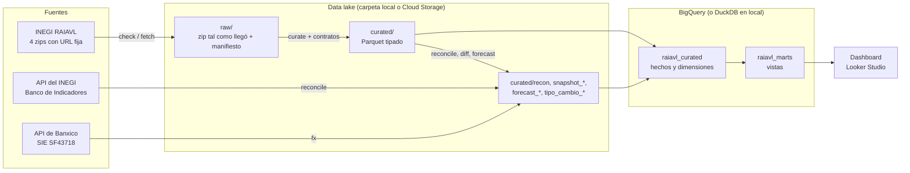

# Arquitectura

Pipeline por lotes que guarda cada publicación mensual del INEGI como una foto
inmutable, la convierte en Parquet tipado, la valida y la concilia contra la API del
INEGI, compara publicaciones, pronostica y carga un warehouse en BigQuery. Python mueve
y valida; SQL transforma.

## Flujo



Cada etapa es un comando de la CLI (`check`, `fetch`, `curate`, `reconcile`, `fx`,
`diff`, `forecast` y `warehouse`), y `run` encadena el ciclo completo. Qué lee y qué
escribe cada uno, su configuración y el ciclo mensual están en
[operacion.md](operacion.md).

## Ejecución en la nube

Un Cloud Run Job corre `inegi-market run` todos los días, disparado por Cloud
Scheduler. Casi siempre solo pregunta al INEGI si hay algo nuevo y termina en segundos;
con una publicación nueva corre el ciclo completo sobre el lake en Cloud Storage y
refresca BigQuery. La infraestructura está en Terraform, los tokens en Secret Manager y
cada push a `main` publica una imagen etiquetada con el SHA del commit. Detalle:
[despliegue.md](despliegue.md).

## Capas del lake

```text
raw/       lo que llegó de las fuentes, sin cambios
  raiavl/<producto>/publication_date=AAAA-MM-DD/   zip original, metadato y manifest.json
  inegi_api/<indicador>/retrieved_at=AAAA-MM-DD/   respuesta de la API (sin token)
  banxico/sf43718/retrieved_at=AAAA-MM-DD/         respuesta de la API (sin token)
curated/   Parquet tipado: hechos, catálogos y resultados de conciliación, diff y pronóstico
reports/   resúmenes JSON de cada ejecución de curate, reconcile, diff y forecast
state/     cabeceras de la última versión descargada de cada zip
```

La ruta completa de cada archivo y el comando que lo escribe están en
[operacion.md](operacion.md#estructura-del-lake).

## Módulos (`src/inegi_market/`)

| Módulo | Responsabilidad |
| --- | --- |
| `config.py` | configuración desde variables `INEGI_MARKET_*` |
| `storage.py` | interfaz común `LocalStorage` / `GCSStorage` |
| `ingest.py` | zip → raw, con manifiesto y sha256 por zip y por archivo |
| `sources/http_client.py` | cliente HTTP inyectable y reintentos |
| `sources/zip_http.py` | detector de publicación nueva y descarga |
| `sources/inegi_api.py`, `sources/banxico_api.py` | clientes de las APIs |
| `curate.py` | raw → Parquet tipado y normalizado ([reglas](reglas_curated.md)) |
| `validate.py` | contratos de datos ([contratos](contratos.md)) |
| `reconcile.py` | conciliación contra la API del INEGI |
| `fx.py` | tipo de cambio a raw y curated |
| `diff.py` | cambios entre fotos clasificados por causa |
| `forecast.py` | pronóstico con backtesting ([pronóstico](pronostico.md)) |
| `warehouse.py` + `sql/` | warehouse en BigQuery o DuckDB ([warehouse](warehouse.md)) |
| `pipeline.py` | ciclo completo y registro de la última publicación procesada |
| `cli.py` | línea de comandos |

## Principios de diseño

- **Fotos inmutables.** Cada publicación se identifica por la fecha `modified` de su
  metadato y nunca se sobrescribe. Un zip regenerado con los mismos datos no cuenta como
  cambio (se compara el sha256 de cada archivo, no del zip); una corrección silenciosa
  detiene la ingesta.
- **Detectar sin descargar.** Un HEAD por zip basta. Las réplicas del servidor del INEGI
  devuelven `ETag` distintos y `Last-Modified` que difieren hasta 4 s para el mismo
  archivo, así que una publicación es nueva solo si `Last-Modified` se mueve más de 10
  minutos.
- **Idempotencia.** Repetir cualquier comando no duplica nada: la ingesta compara sha256,
  curated reescribe los mismos bytes y el warehouse es todo `CREATE OR REPLACE`.
- **Un lote malo no se propaga.** Los contratos corren antes de escribir curated, y la
  conciliación termina con error si un mes queda fuera de tolerancia.
- **El mismo código en local y en la nube.** El almacenamiento es una interfaz; el SQL de
  BigQuery se traduce con sqlglot y corre en DuckDB sobre el lake local.
- **Sin secretos en el repositorio.** `INEGI_TOKEN` y `BANXICO_TOKEN` solo se leen del
  entorno y se borran de cualquier mensaje y de las respuestas guardadas.

## Pruebas

Las pruebas no usan red ni credenciales: el servidor del INEGI, sus APIs, Banxico y
BigQuery se sustituyen por dobles, y los datos de prueba son recortes de 71 KB de las
publicaciones reales ([fixtures](../tests/fixtures/README.md)). El SQL se ejecuta en
DuckDB sobre un lake de fixtures. GitHub Actions corre `ruff` y `pytest` en cada push.
